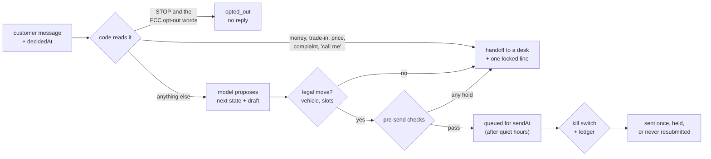

# showroom

Run a sales agent like a product. The model writes the words; code owns the journey, the
numbers and the commitments, and every claim of success is checked against a system the agent
can't write.

1. **A typed journey state machine.** Every lead is in one state: `new → engaged → qualified →
   vehicle_confirmed → drive_offered → booked → confirmed → handed_off` (plus `opted_out` and
   `closed`). The model proposes the next state; code checks the move is legal and that its
   facts hold (the vehicle is available, the drive slots are inside store hours, the booked
   time was one we offered).
2. **Pre-send checks that can only hold.** A draft that quotes a price inventory didn't return
   (with or without a dollar sign, or in words), offers a discount, an out-the-door figure or a
   guarantee, talks payments, APR, credit or approval, asks for an SSN or a date of birth, names
   a time nobody offered, says "tomorrow" when it won't go out today, or breaks tone, is held. A
   check returns a reason, never new text. A held draft becomes a handoff to the desk that owns
   it, never silence.
3. **Transcript backtests labeled by what happened next.** Each customer message in a past
   thread is graded against what the store actually did next (a routine reply, a person or a
   desk, nothing, an opt-out), not against anyone's opinion of the transcript. Failures are
   tagged by mode, and every real misread becomes a regression fixture.
4. **Holdouts read from the sales record.** Leads are split by a hash of the lead ID, the
   primary metric is written down and hashed before launch, and the readout reads sales only
   from the dealer's sales record. Point it at the agent's own booking log and it refuses.
5. **A send path for shadow and live.** A kill switch re-read every cycle, sends held in quiet
   hours, a STOP or a handoff that arrives after a reply was queued holds that reply, and a
   write-ahead ledger: a send whose answer was lost is looked up, never resent.

TypeScript on Node 22.18+ (run directly, no build step), with a standard-library Python
readout for the holdout. MIT. Everything here runs on synthetic data and a scripted or
stand-in model, so it needs no API key.

Terms: a **handoff** is the moment the agent passes the customer to a person. A **holdout** is
the share of leads kept on the human process as the control group. A **pre-registered
metric** is the success measure written down before launch, so it can't be chosen after the
results come in.

## One turn



A question the model answers with silence is also a handoff. A message on a lead a person
already owns goes to that person. A message that may be an opt-out without saying so plainly
("wrong number", "no more texts") goes to a person with no reply at all.

## Two-minute demo

```sh
pnpm install
mkdir -p .out
```

**1. A used-EV lead at 9:52 pm.** The model's proposals are scripted in
`examples/lead-0952pm.json` so the demo is the same every time; everything else is the real
pipeline.

```text
$ pnpm -s showroom run examples/lead-0952pm.json --queue .out/outbox.jsonl
lead-0952pm  2023 electric crossover, long range (U4821), listed $31,900, available
model: scripted: each turn's proposal stands in for a model's output

turn 1  decidedAt Wed 2026-11-04 9:52 pm  (quiet hours 21:00-08:00)
  customer  hi is the crossover still there? can I see it after work?
  reading   ask
  draft     Hi, it's still here. I can have it charged and up front Thursday at 5:30 pm or 6:15 pm. Which works better?
  state     new -> engaged -> drive_offered
  sends     queued for Thu 2026-11-05 8:00 am, when quiet hours end
  reply     Hi, it's still here. I can have it charged and up front Thursday at 5:30 pm or 6:15 pm. Which works better?

turn 2  decidedAt Thu 2026-11-05 8:41 am
  customer  6:15 works
  reading   other
  draft     You're set for Thursday at 6:15 pm. Ask for the front desk when you get here.
  state     drive_offered -> booked
  sends     now
  reply     You're set for Thursday at 6:15 pm. Ask for the front desk when you get here.
```

The reply is decided at 9:52 pm and goes out at 8:00. It names Thursday rather than
"tomorrow": had the draft said "tomorrow", `day_words_match_send_day` would have held it,
because by the time it lands, tomorrow is Friday.

**2. The model talks payments.** Nothing in "what would it run me?" trips a money rule, so the
model drafts. The draft states a monthly payment, and the turn becomes a handoff:

```text
turn 3  decidedAt Thu 2026-11-05 12:40 pm
  customer  great. what would it run me? trying to stay around 700
  reading   ask
  draft     It's listed at $31,900. With good credit that's about $689 a month.
  HELD      no_payment_terms: "credit", "a month": payments, rates, credit and approval belong to the finance desk
  HELD      price_from_inventory: $689 not a price the inventory returned (it returned U4821 $31,900)
  state     booked -> handed_off
  handoff   finance desk (check: no_payment_terms)
  sends     now
  reply     Good question. I'm getting you the right person for it, and they'll text you from this number.
```

The $31,900 passes: it is the value inventory returned. The $689 never reaches the customer.

**3. Replay 200 synthetic threads.**

```text
$ pnpm -s showroom backtest examples/transcripts --gate .out/gate
200 threads, 464 customer messages.
Scored 396 against what happened next; agreed on 340 (85.9%).
Not scored: 6 where the agent wrote the next step (never a label), 61 after a person took the lead, 1 with no outcome yet.

label \ agent       reply  handoff no_reply  opt_out
reply                 181        0       17        0
handoff                 6       92       20        0
no_reply                0       13       55        0
opt_out                 0        0        0       12

By journey state when the customer wrote:
state                 n  agree  failure modes
new                 198    164  silent_on_ask 28, missed_handoff 6
engaged               7      7
drive_offered       105     96  silent_on_ask 9
booked               86     73  extra_handoff 13

Failure modes:
  silent_on_ask     37  e.g. t-0001#0 "still around? my sister wants to see it"; t-0001#2 "would love to take it for a spin this weekend"
  extra_handoff     13  e.g. t-0006#4 "haha my brother says call me crazy for going electric. see you then"; t-0011#4 "the loan officer at my credit union already sorted it, see you then"
  missed_handoff     6  e.g. t-0032#0 "could you guys take my old truck off my hands too?"; t-0054#0 "could you guys take my old truck off my hands too?"

Regression fixtures: 11 of 11 pass.

Wrote 464 agent decisions and 396 human labels to .out/gate/ in autonomy-gate's format.
```

The agent here is the code-owned half (reading, routing, the journey and the checks) driven by
`routineModel`, a stand-in that writes only locked copy. The 85.9% measures nothing about any
real model. Every disagreement comes from a phrasing `scripts/synth.ts` plants because people
text that way: buyer intent in casual words ("I've got about a 650 score, is that going to be
an issue"), and handoff words in messages that need nothing ("call me crazy"). That is what a
replay of real threads is for.

`examples/transcripts/regressions.jsonl` holds the fixtures. Eight are the five misread
families a replay of my own lead system found on 2026-10-13, reworded for a dealership. The
first one: "Can I have your number?" must read as an ask and go to a salesperson. Put the old
rule back (add `have` to the second `NOT_YET` pattern in `src/intent.ts` and drop
`CONTACT_REQUEST` from `TRIGGERS`) and it reads as "maybe later" and fails;
`test/intent.test.ts` does exactly that to prove the fixture catches it.

**4. The holdout readout.**

```text
$ python3 analysis/holdout.py examples/experiment
showroom-synthetic-pilot: pre-registration unchanged since launch (sha256 d669259baac2).
Primary metric sold_within_30_days, read from sales.csv (dealer_sales_record).
2000 leads enrolled; arms re-derived from lead_id, all match. 40 leads outside the enrollment window left out.
  agent     1601 leads    83 sold    5.18%  [4.20%, 6.38%]
  holdout    399 leads    21 sold    5.26%  [3.47%, 7.91%]
  difference -0.08 points, 95% CI [-2.90, +2.08], two-sided p = 0.95
  At these sizes the smallest difference this test reliably sees is about 3.5 points; the pre-registration planned for 2.0.
Result: no difference detected at alpha 0.05; underpowered for the planned effect.

$ python3 analysis/holdout.py examples/experiment --outcomes examples/experiment/agent-bookings.jsonl
refused (ProvenanceError): agent-bookings.jsonl row 1 was written by showroom, an agent system; the primary metric reads only dealer_sales_record
```

The generator gives both arms the same sale rate, so "no difference" is the right answer, and
the readout says so. It also says the thing an executive needs before a pilot starts: an
80/20 split of 2,000 leads can't see a 2-point change. The agent's booking log exists only for
the agent arm, so reading it as the outcome would manufacture a lift from nothing; that is why
it is refused. The readout also refuses a pre-registration edited after launch (its sha256 is
in `launch.json`), any outcome file other than the pre-registered one, any row an agent
system wrote, a lead whose recorded arm disagrees with its hash, and any run before
`readoutNotBefore`.

**5. Kill switch, then a crash mid-send.**

```text
$ S="send .out/outbox.jsonl --ledger .out/ledger.jsonl --switch .out/switch.txt --live"
$ pnpm -s showroom switch .out/switch.txt on
.out/switch.txt: on
$ pnpm -s showroom $S --now 2026-11-05T08:00:00-08:00
  lead-0952pm@2026-11-04T21:52:00-08:00     sent                            receipt
  lead-0952pm@2026-11-05T08:41:00-08:00     not_due                         goes out Thu 2026-11-05 8:41 am
  lead-0952pm@2026-11-05T12:40:00-08:00     not_due                         goes out Thu 2026-11-05 12:40 pm
$ pnpm -s showroom switch .out/switch.txt off
.out/switch.txt: stop
$ pnpm -s showroom $S --now 2026-11-05T08:45:00-08:00
  lead-0952pm@2026-11-04T21:52:00-08:00     done                            sent
  lead-0952pm@2026-11-05T08:41:00-08:00     held                            kill_switch: .out/switch.txt says 'stop'; a person takes it
  lead-0952pm@2026-11-05T12:40:00-08:00     not_due                         goes out Thu 2026-11-05 12:40 pm
$ pnpm -s showroom switch .out/switch.txt on
.out/switch.txt: on
$ SHOWROOM_DEMO_CRASH=before_write pnpm -s showroom $S --now 2026-11-05T12:41:00-08:00   # dies inside send()
$ pnpm -s showroom $S --now 2026-11-05T12:42:00-08:00
  lead-0952pm@2026-11-04T21:52:00-08:00     done                            sent
  lead-0952pm@2026-11-05T08:41:00-08:00     done                            held
  lead-0952pm@2026-11-05T12:40:00-08:00     unconfirmed_never_resubmitted   found in sending at start; lookup has no receipt
```

The ledger row `sending` is written and synced before the sender is called. On restart, a
row still in `sending` is settled by looking its request ID up at the sender, never by
sending again. With `after_write` the lookup finds the receipt and it ends `sent`, still
exactly once. Without `--live` the same command only logs (`shadowed`).

`run --queue` writes every turn, including the ones that send nothing, and each cycle re-reads
each lead's latest turn before anything goes out. If the customer texts STOP at 10:30 pm,
after the 9:52 pm reply was queued for 8:00, the 8:00 cycle holds the reply
(`stop_honored: the customer opted out; nothing may be sent`) and the provider gets nothing.
If a person took the lead after a reply was queued, the reply is held for that person and the
handoff line still goes. A reply that says "today" or "tomorrow" is checked again at the
moment it would actually go out, and held if that is a later day than it was decided.

## Why I built this

I sold Harley-Davidsons on an Orange County dealer floor, then worked 2019 to 2021 as a loan
officer licensed in 14 states. I know how a sale dies between the inquiry and the callback:
you talk to a borrower for 30 days, and at the last minute they go with a different company.

In 2026 my hauling company, OC Junk Removers, put a number on it. An October review of its
lead system found that about 3% of qualified leads had ever gotten a decision from a person,
after a median wait of about two hours. Building the agent that triages them, I hit the
sales-agent failures one after another. For three weeks from September 17, a reminder job
reported success every minute while sending nothing. On October 9 the first replay scored
0.86 precision but only 0.54 recall, partly because the request carried no clock: the model
judged dates by its own idea of today. On October 13 a replay of 1,399 past messages caught
my own rules reading "Can I have your number?" as "maybe later", and found 19 explicit asks
that had never alerted anyone.

Showroom is what I'd want on day one of running a sales agent: the journey as a typed state
machine, code that owns every number and commitment, replays graded by what happened next,
and a holdout read from the sales record. Its first rules are the ones from my own lead
system, generalized and reworded for a dealership: STOP honored, money questions, complaints
and refunds sent to a person, an ask never closed by a decline word, and a blocked template
turned into an alert instead of silence. At home that last rule covered the service and quote
templates; here every held draft becomes a handoff. No customer data is in this repository.
On my own agent I've run owner-label replays and shadow mode; I have never run a randomized
holdout, so the holdout here shows the method on synthetic data and claims no lift.

— Jacob Lopez

## Plugging in

- **A model.** Implement `Model.propose(request) → Proposal` (`src/model.ts`). Every request
  carries `decidedAt` and `sendAt`; `checkRequest` refuses one without a zoned time, and a
  test fails if any `.propose()` call in `src/` skips it. A proposal is a next state, a draft
  or `null`, and for drive offers the slots. A thrown error or a malformed proposal becomes a
  handoff.
- **A store.** `examples/store.json`: time zone, quiet hours, drive hours, tone limits.
  `examples/inventory.json`: the only source of a price.
- **A sender.** `Sender.send(requestId, leadId, text)` and `Sender.lookup(requestId)`
  (`src/send.ts`). Use `requestId` as the idempotency key.
- **Transcripts.** One thread per line: events `customer`, `template` (a routine reply someone
  sent), `staff` (a person typed it), `transfer` (to a desk), `system` (`opted_out`), and
  `agent` (the agent wrote it, so it is never a label). A label is the first non-customer
  event within 48 hours, before the customer writes again.
- **The go-live gate.** `backtest --gate` writes the agent's decisions and the human labels in
  [autonomy-gate](https://github.com/woodbeary/autonomy-gate)'s record format (reply = approve,
  handoff = hold, no reply or opt-out = skip), so its bars decide when shadow may become live.
  On the synthetic export it stays RED on one bar, p95 decision time, because the stand-in has
  no measured latency. That is the right answer until a real model runs in shadow.

## Next to a hosted agent platform

Showroom isn't an agent runtime. If the conversation runs on a hosted platform, its parts sit
at the platform's edges, wherever code can see a proposal before it is sent:

- The legal-move check and the pre-send checks gate the draft. A hold comes back as a handoff
  naming the desk and the check, for the platform's own transfer.
- `backtest` reads exported transcripts. It needs to know who wrote each step, so that an
  agent-written step is never used as a label.
- The holdout splits leads before they reach the platform, and the readout never reads the
  platform's own logs.

τ²-bench is the public point of comparison. It runs an agent against a written domain policy,
with tools and an LLM-simulated customer, and scores each conversation by the state it leaves
behind, with pass^k over repeated trials. That measures whether the agent follows the policy.
Showroom measures the two things a sales team asks next: whether the agent did what a person
did with real customers, and whether more cars sold. I haven't run τ²-bench against anything
here.

## What was tested

- `pnpm test`: 66 tests with `node:test`, passing locally on Node 22.22 and 24.15. They cover
  the legal moves and terminal states; the inbound rules against every regression fixture,
  and the pre-fix rules failing the "have your number" fixture; every opt-out word in 47 CFR
  64.1200(a)(10) and the carrier keywords reading as STOP, and possible opt-outs going to a
  person with no reply; each pre-send check holding and passing, including prices with no
  dollar sign or in words, and discount, out-the-door and guarantee wording; quiet hours
  across the November DST change; the three-turn demo end to end; a money question handing
  off before the model is called; illegal moves, silent answers and model errors becoming
  handoffs; the `decidedAt` lint over `src/`; label derivation, including that no label ever
  comes from an agent-written step; the 200-thread backtest counts; hash assignment against
  shared vectors; the kill switch, shadow mode, quiet hours and a send that raises; a STOP or
  a handoff after a reply was queued holding that reply, and "today" re-checked at the
  actual send time; and a real child process that dies with exit code 137 inside `send()`,
  before and after the provider write, then restarted twice, with exactly the expected
  number of deliveries.
- `pnpm typecheck`: `tsc --strict` with `noUncheckedIndexedAccess` and
  `exactOptionalPropertyTypes`, clean.
- `python3 -m unittest discover -s analysis`: 11 tests, passing locally on Python 3.11, 3.12
  and 3.13. They check the assignment against the same vectors as the TypeScript runtime,
  Wilson intervals against known values, the 30-day window edges, the example readout, and
  each refusal.
- autonomy-gate at commit `d0b348c`, run locally on the `--gate` export:
  `autonomy-gate lint .out/gate/labels.jsonl` passes on 396 labels, and
  `autonomy-gate check --shadow .out/gate/shadow.jsonl --labels .out/gate/labels.jsonl` is
  RED on p95 decision time only, as above.
- CI runs the TypeScript suite on Node 22 and 24, the Python suite on 3.11 to 3.13, the
  README's demo commands, and checks that `pnpm synth` regenerates the synthetic threads and
  experiment byte for byte.

Not tested: a real model, a real messaging provider, a real dealer's sales record, or more
than one runner sharing a ledger (run one runner per ledger).

## Limits

- The synthetic threads share vocabulary with the rules, so the plain phrasings agree by
  construction. Only the planted phrasings test anything, and only the ones I thought of.
- The readout's assignment is per lead ID. If one shopper can arrive as two leads (a text and
  a web form), dedupe to a person ID first, or the same person can land in both arms.
- Quiet hours (21:00 to 08:00 here) are a store setting, not legal advice, and they are
  computed in the store's time zone. A store that texts customers in other zones needs each
  customer's zone.
- The price check is an allow-list of inventory prices over money written in digits or
  words; a figure in a phrasing it doesn't recognize still gets through.
- Rules are English-only regular expressions; a misread in another language won't be caught.
- `routineModel` is a stand-in for the replay, not a model to ship.

## License

MIT. See [LICENSE](LICENSE).
